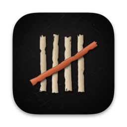
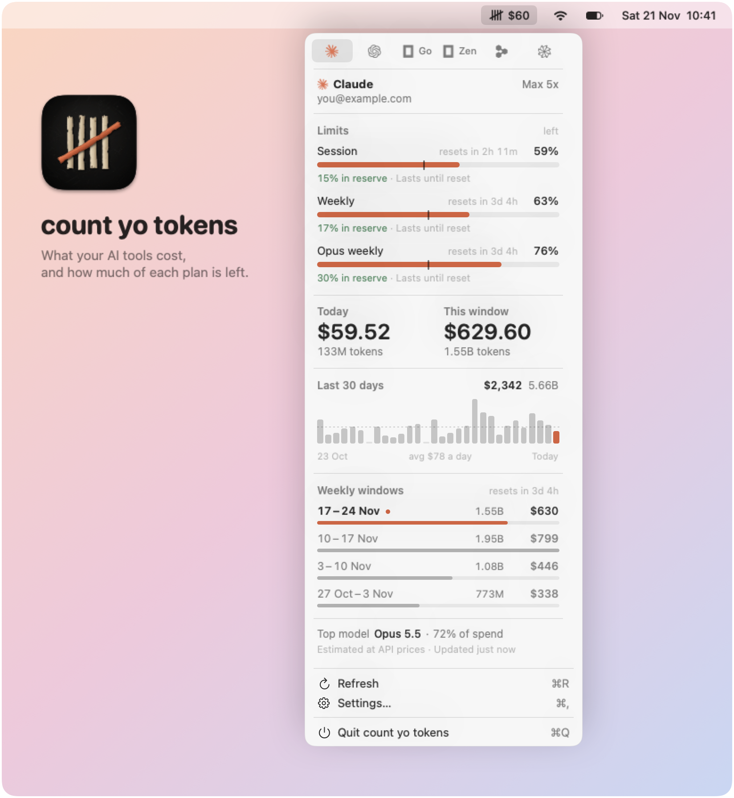
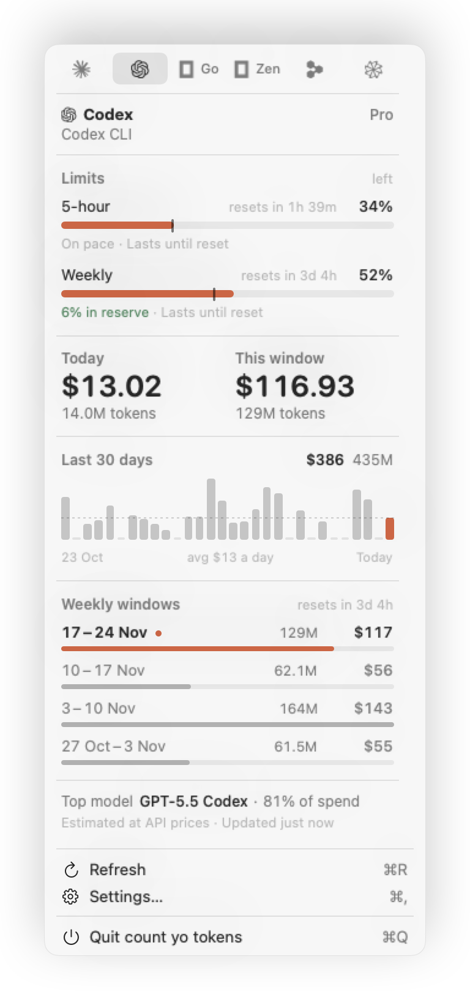
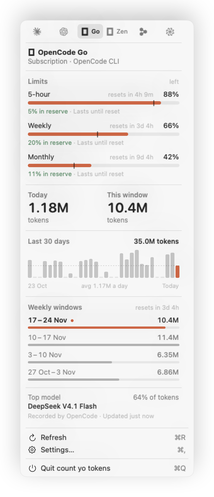
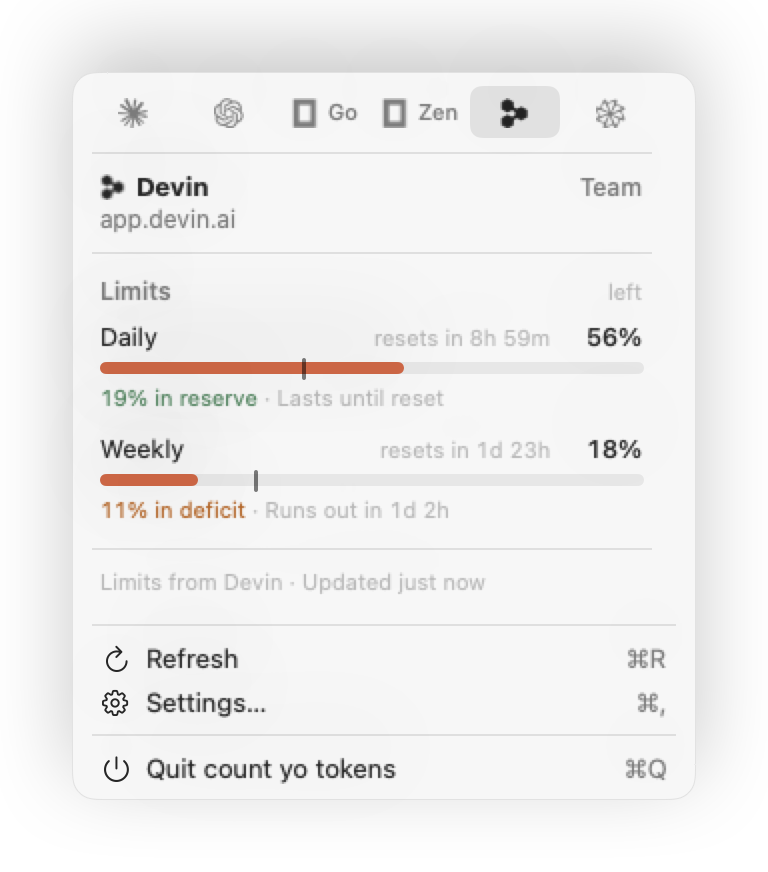
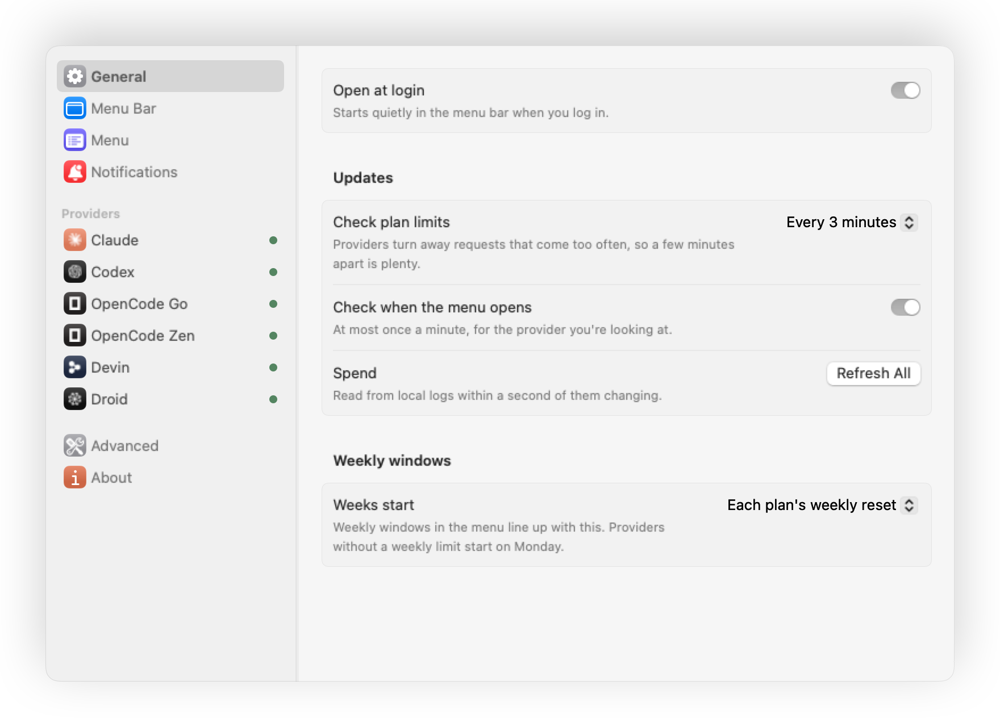
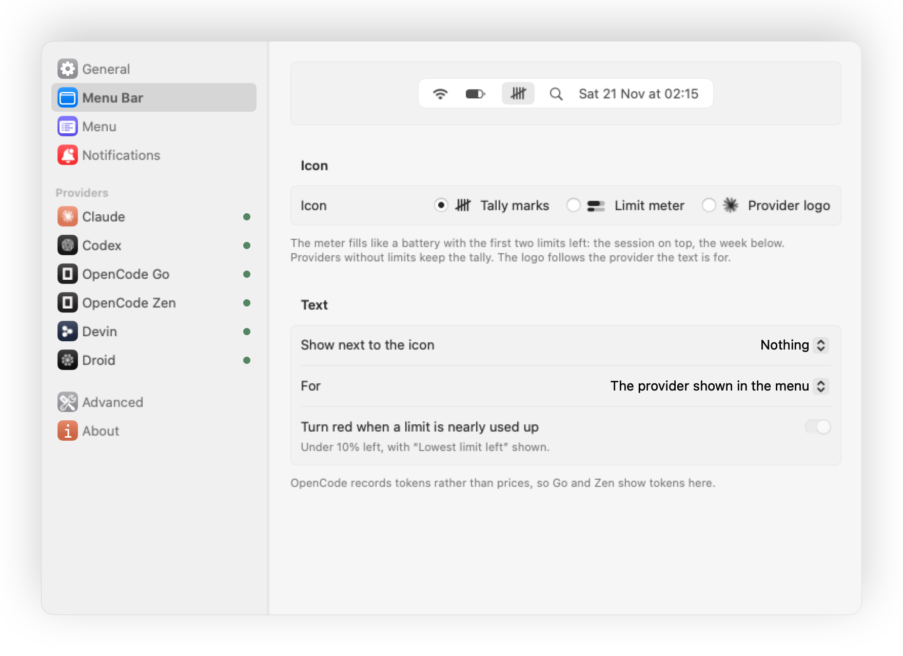
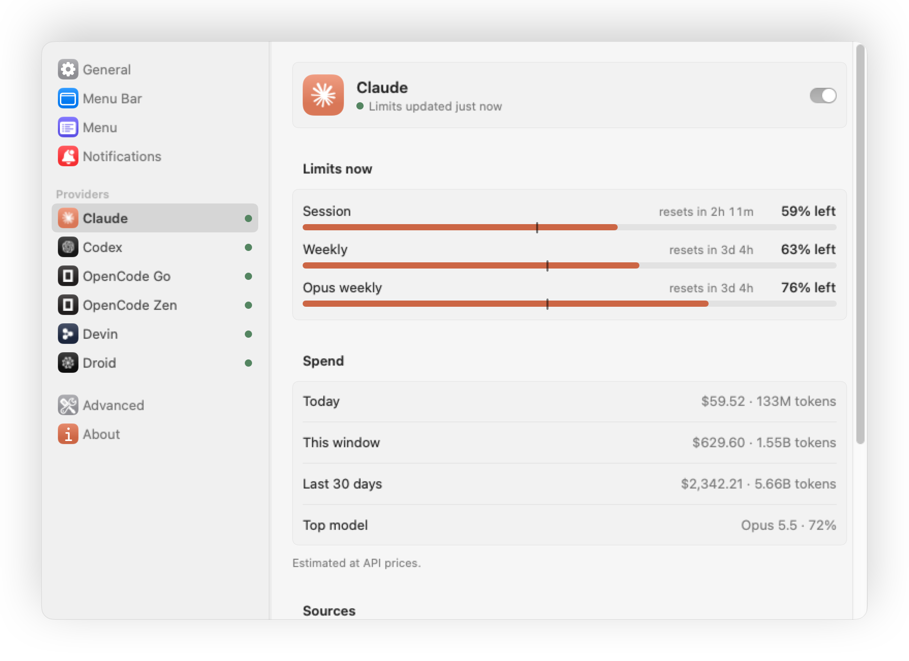
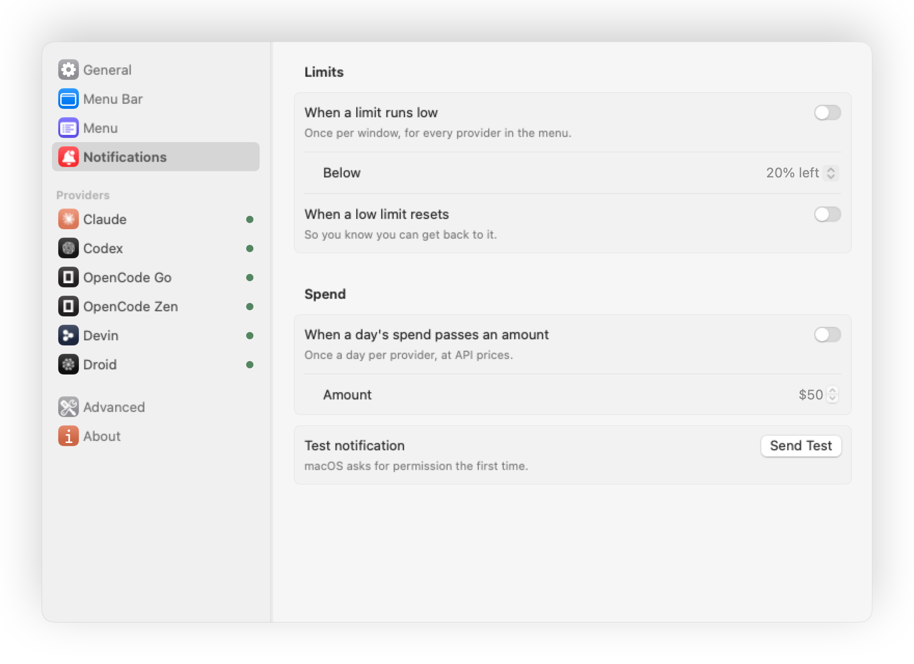

<p align="center">
  
</p>

<h1 align="center">count yo tokens</h1>

<p align="center">
  A tiny macOS menu bar app that shows what your AI coding tools cost<br>
  and how much of each plan you have left.
</p>

<p align="center">
  <a href="https://github.com/sirrayi/countyotokens/releases/latest"></a>
  
  
  <a href="LICENSE"></a>
</p>

<p align="center">
  <picture>
    <source media="(prefers-color-scheme: dark)" srcset="docs/images/hero-dark.png">
    
  </picture>
</p>

<p align="center"><sub>Every screenshot here uses the built-in demo data, not anyone's real usage.</sub></p>

## What it does

- **Limits at a glance.** Session, weekly, monthly or daily limits for each plan, with how much is
  left, when it resets, and your pace: how far ahead of or behind an even spread you are, and
  whether what's left lasts until the reset.
- **What it costs.** Today, this window, the last 30 days as daily bars, the last four weekly
  windows, and the model you lean on most. Costs are worked out from your local logs at API list
  prices. Tools that only record tokens show tokens instead.
- **Six providers, one icon.** Claude, Codex, OpenCode Go, OpenCode Zen, Devin and Droid. Use the
  switcher at the top of the menu to move between them.
- **Instant.** The last result shows the moment the app starts, and new log lines are picked up
  within a second of being written.
- **Local first.** Spend is read from files already on your Mac. Plan limits come straight from
  each provider, using credentials that the provider's own tool already holds or that you paste in.
  Nothing else leaves your machine. No analytics, no accounts, no auto-updater.

<table>
  <tr>
    <td align="center" width="33%">
      <picture>
        <source media="(prefers-color-scheme: dark)" srcset="docs/images/card-codex-dark.png">
        
      </picture>
      <br><sub><b>Codex</b>: limits and spend</sub>
    </td>
    <td align="center" width="33%">
      <picture>
        <source media="(prefers-color-scheme: dark)" srcset="docs/images/card-opencode-go-dark.png">
        
      </picture>
      <br><sub><b>OpenCode Go</b>: shown in tokens</sub>
    </td>
    <td align="center" width="33%" valign="top">
      <picture>
        <source media="(prefers-color-scheme: dark)" srcset="docs/images/card-devin-dark.png">
        
      </picture>
      <br><sub><b>Devin</b>: reserve and deficit</sub>
    </td>
  </tr>
</table>

## Install

1. Download `count-yo-tokens-<version>.zip` from the
   [latest release](https://github.com/sirrayi/countyotokens/releases/latest) and unzip it.
   The app runs natively on Apple silicon and Intel.
2. Move **count yo tokens.app** to **Applications**.
3. Open it. The build is ad-hoc signed, not notarized, so macOS will block the first launch.
   To allow it, either:
   - open **System Settings → Privacy & Security**, scroll down and click **Open Anyway**, or
   - remove the quarantine flag in Terminal:

     ```bash
     xattr -dr com.apple.quarantine "/Applications/count yo tokens.app"
     ```

The app lives only in the menu bar: look for the tally marks. Open **Settings…** (⌘,) from the
menu to choose providers and turn on **Open at login**.

If you'd rather not run a binary you didn't build, [build it yourself](#build-from-source). It
takes about a minute.

## Providers

| Provider | Spend, from | Limits, via |
|---|---|---|
| **Claude** | Claude Code and pi/omp logs, priced at Anthropic list prices | Claude Code's sign-in: session, weekly, and any model-scoped weekly limits |
| **Codex** | `~/.codex/sessions`, priced at OpenAI list prices | `~/.codex/auth.json`: 5-hour and weekly |
| **OpenCode Go** | OpenCode's own history (`opencode.db`), as recorded | The Go key OpenCode holds: 5-hour, weekly, monthly |
| **OpenCode Zen** | OpenCode's own history, as recorded | None (pay as you go) |
| **Devin** | — | A token you paste in Settings: daily and weekly |
| **Droid** (Factory) | — | An API key you paste in Settings: standard and premium, or 5-hour, weekly, monthly |

Model prices come from the [models.dev](https://models.dev) catalogs. A snapshot is built in, and it
is refreshed at most once a day.

## Settings

<table>
  <tr>
    <td width="50%">
      <picture>
        <source media="(prefers-color-scheme: dark)" srcset="docs/images/settings-general-dark.png">
        
      </picture>
    </td>
    <td width="50%">
      <picture>
        <source media="(prefers-color-scheme: dark)" srcset="docs/images/settings-menu-bar-dark.png">
        
      </picture>
    </td>
  </tr>
  <tr>
    <td width="50%">
      <picture>
        <source media="(prefers-color-scheme: dark)" srcset="docs/images/settings-claude-dark.png">
        
      </picture>
    </td>
    <td width="50%">
      <picture>
        <source media="(prefers-color-scheme: dark)" srcset="docs/images/settings-notifications-dark.png">
        
      </picture>
    </td>
  </tr>
</table>

- **General**: open at login; how often limits are checked (2–15 minutes, or only on request) and
  whether opening the menu checks too; which day weekly windows start (each plan's own weekly
  reset, or a fixed weekday).
- **Menu Bar**: the icon (tally marks, a meter that fills with your first two limits, or the
  provider's logo); what sits next to it (nothing, today's spend, this window's spend, or the
  lowest limit left); turning it red under 10% left.
- **Menu**: show or hide each section; limits as left or used; resets as a countdown or a time;
  hide your email while screen sharing.
- **Notifications**: when a limit runs low (50, 25, 20, 10 or 5% left), when a low limit resets,
  and when a day's spend passes an amount you set.
- **Providers**: one pane each, dragged to set the switcher order. Each shows its current limits
  and spend, plan and account, and where its figures come from.
- **Advanced**: update model prices, show the data folder, remove saved keys, reset settings.

## Privacy and security

- **Credentials are only ever read.** They are never refreshed, rewritten or copied:
  - Claude Code's Keychain item, through `/usr/bin/security`, which that item already trusts.
  - Codex's `auth.json`.
  - OpenCode's credential table, opened read-only.
- **Keys you paste stay in your login Keychain.** That covers Devin and Factory.
- **Each token goes only to its own provider, over HTTPS.** It is never logged or written anywhere
  else.
- **Nothing is read from your browser.** No cookies, no local storage.
- **Requests are kept light.** Limits are checked every few minutes, and the app backs off when a
  server asks it to.
- **No telemetry.** The only other network request fetches the public model price list.

## Build from source

Requires macOS 15 and Swift 6 (Xcode 16 or later, or the matching command line tools).

```bash
git clone https://github.com/sirrayi/countyotokens.git
cd countyotokens
./Scripts/build_app.sh             # builds dist/count yo tokens.app
./Scripts/build_app.sh --install   # copies it to /Applications and launches it
./Scripts/build_app.sh --zip       # universal build, zipped for a release
```

The project has three targets:
- `TokenCore` (log scanning, pricing, limits)
- `CountYoTokens` (the app)
- `tokbench`, a small command line tool for timing scans and fetching limits once.

```bash
swift run -c release tokbench 5                       # a cold scan and five warm refreshes
swift run -c release tokbench limits claude codex     # fetch limits once
swift run -c release tokbench spend claude opencode-go
```

### Screenshots and checks

These flags are for development, not everyday use:

| Command | What it does |
|---|---|
| `CountYoTokens -demo YES` | Fills every provider with made-up data and reads nothing. |
| `CountYoTokens -demo YES -readme <folder>` | Redraws the images in this README. |
| `CountYoTokens -snapshot <folder>` | Draws every menu and Settings pane to PNGs at 2x. |
| `CountYoTokens -menuProbe <folder>` | Opens the real menu for each provider. It checks every section's height, looks for overlaps, and confirms the app stays responsive. It briefly takes the screen, so leave the keyboard alone. |
| `-enabledProviders '(claude,codex,"opencode-go",zen,devin,droid)'` | Added to any of these, covers every provider for that run without changing your settings. |

`Scripts/make_icon.sh` redraws the app icon from code (`Scripts/make_icon.swift`).

## How refresh stays instant

- The last result is saved and shown as soon as the app starts.
- Each log file remembers how far it has been read, so a refresh parses only the bytes appended
  since. Files untouched since the oldest day shown are never opened.
- Cold scans map files into memory and parse them in parallel, biggest first. Lines are filtered
  with `memmem` before any JSON is decoded.
- De-duplication across files is updated incrementally, so unchanged data reuses the last result.
- FSEvents triggers a refresh within a second of a log, or OpenCode's database, changing.

## Credits

count yo tokens began as a hard fork of [CodexBar](https://github.com/steipete/CodexBar) by Peter
Steinberger (MIT) and has since been cut down and redesigned. The provider marks are vector logos
taken from CodexBar. They are trademarks of their owners and are used only to identify each
service. This project isn't affiliated with or endorsed by Anthropic, OpenAI, OpenCode, Cognition
or Factory.

## License

[MIT](LICENSE)
